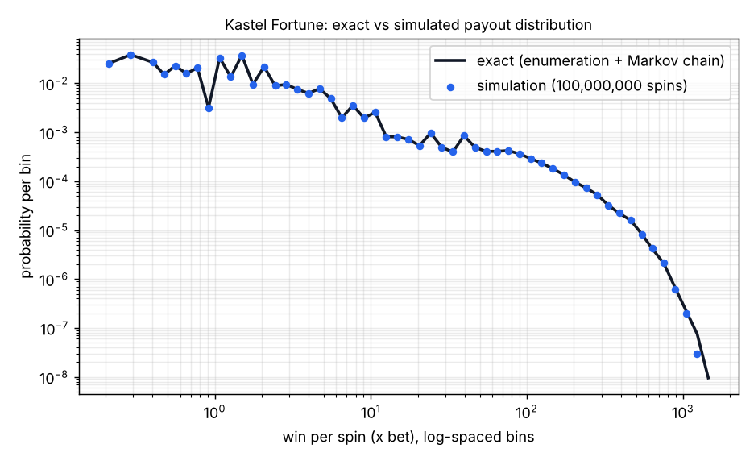

# game-math-portfolio

Exact mathematics for slot games: reel-strip models solved by full enumeration,
free-spins features solved as absorbing Markov chains (to the full payout
distribution, not just the mean), Monte-Carlo verification with confidence
intervals, calibration tooling and PAR sheets.

Three games:

| Game | What | Exactness |
|---|---|---|
| **Kastel Fortune** — original design | 5x3, 20 lines, free spins with a multiplier ladder (x1→x5) and retriggers, 1,500x cap | base game: all 55,520,640 stop combinations enumerated; feature: Markov chain solved to the full distribution; 10⁸-spin simulation as the independent check |
| **Sugar Heaven — reference model** | our model fitted to the public spec of Just Slots' *Sugar Heaven* (20 lines, multiplier wilds, sticky wilds in 8/9/12 free spins, RTP 96.42 %, hit 31 %, 5,000x, bonus buy 100x) | base game exact (77,096,604 combinations); sticky-wild feature by simulation with a 95 % CI |
| **Book of Arcane 100 — reference model** | our model fitted to the public spec of Just Slots' *Book of Arcane 100* (10 lines, Book = wild + scatter paying 2/20/200x, expanding symbol, 1x–100x multiplier, retriggers, RTP 96.36 %, hit ~27 %, 100,000x) | everything exact: enumeration + Markov chain mixed over 9 expanding symbols and 8 multipliers, 100,000x cap folded exactly |

> The reference models are *not* the providers' proprietary math (reel strips and
> paytables are never published). They are original models whose mechanics and
> headline numbers match the public specification — which is exactly the job a
> game mathematician does when handed a design brief.

## Headline results

| | Kastel Fortune (original) | Sugar Heaven ref. | Book of Arcane ref. |
|---|---|---|---|
| Public target | — (design: 96.20 %) | RTP 96.42 %, hit 31 %, 5,000x | RTP 96.36 %, hit ~27 %, 100,000x |
| RTP | **96.2022 %** exact | **96.486 % ± 0.23 pp** (exact base + simulated feature) | **96.3600 %** exact |
| RTP split (lines / scatters / feature) | 58.71 / 1.28 / 36.22 % | 51.16 / 1.05 / 44.28 % | 53.22 / 1.64 / 41.52 % |
| Hit frequency (exact) | 34.81 % | 33.08 % | 28.03 % |
| Std dev per spin | 7.55x (VI 14.8) | ~13.2x (simulated) | 25.44x (VI 49.9) |
| Feature frequency | 1 in 187 | 1 in 226 | 1 in 181 |
| E[feature payout] | 67.8x (median 47.8x) | 98.3x for 3 scatters → bonus-buy RTP at 100x = 100.0 % | 75.3x (median 37.5x), E[multiplier] 1.308 |
| Max win | 1,500x, P = 1 in 5.2·10⁸ | 5,000x cap | 100,000x, P = 1 in 1.35·10⁸ — hit once in the 2·10⁸-spin run |
| Monte-Carlo check (seed 2024) | 10⁸ spins: 96.192 % ± 0.148 pp, z = −0.13; hit 34.815 %, σ 7.550 | 5·10⁷ spins: 96.208 % ± 0.365 pp (public 96.42 inside), hit 33.084 % | 2·10⁸ spins: 96.322 % ± 0.364 pp, z = −0.20; hit 28.025 % |



The PAR sheets in `docs/` carry every number needed to re-derive the RTP from
scratch (strips, paytable, per-reel symbol probabilities, contribution of every
winning combination, feature statistics, full payout distribution, exact-vs-simulated table).

## How the maths works (short version)

1. **One line.** Each row of each reel shows a uniformly random strip position, so a
   line is five independent symbols with marginals `count/length`. Its expectation is a
   finite sum over all symbol 5-tuples — exact and instant. Every line has the same
   distribution, so line RTP = lines × E[one line].
2. **Scatters.** Rows of one reel are *not* independent (consecutive positions), so the
   per-reel count distribution is read off the strip with a sliding window and the reels
   are convolved.
3. **The whole grid.** Hit frequency and variance need the joint law of overlapping lines:
   enumerate all ∏(strip lengths) stop combinations (equiprobable) in vectorised NumPy
   chunks and histogram (scatter count, line win) on a 0.1x grid. Exact.
4. **Free spins.** State = (spins left, multiplier, retriggers used); "feature over" is
   absorbing. First-step analysis gives `D(s) = Σ_c pay_c(s) ⊛ D(next_c)`. Because every
   transition strictly lowers a potential (spins left + 5 × retriggers remaining), the chain
   is a finite DAG and memoised recursion solves it exactly; multiplying a payout by an
   integer multiplier is a bin re-indexing; the max-win cap is folded after every
   convolution (`min(x+y,C) = min(min(x,C)+y,C)` for y ≥ 0).
5. **Whole spin.** Mixture over the scatter count of (base win shifted by the scatter pay)
   convolved with the feature distribution → exact RTP, hit rate, σ, tail probabilities,
   max-win reachability.
6. **Simulation.** Same engine, random stops, feature played spin-by-spin; CLT interval
   `mean ± 1.96·s/√N`. With σ ≈ 7.5x and N = 10⁸ the interval is ±0.15 pp of RTP.
7. **Calibration.** Symbol counts per strip are the dials; greedy local search on exact
   means + fixed-seed Monte-Carlo hit rate, under design constraints (wild reels, one scatter
   per reel, symbol count bounds). For the Book model the multiplier weights are solved in
   closed form because feature RTP is linear in E[M].

A design finding worth noting: the first Kastel draft advertised a 5,000x max win; the
exact tail showed P(≥ 5,000x) ≈ 2·10⁻¹⁷ — unreachable — so the cap was set at 1,500x
(1 in 5·10⁸). For the Sugar model, the public **bonus-buy price (100x)** pins the feature's
value: a first draft had E[feature] ≈ 128x, i.e. a 128 % bonus-buy RTP exploit; the
free-spin strips were thinned until the buy RTP was ~100 %.

## Excel edition of the model

`docs/Kastel_Fortune_math_model.xlsx` (generated by `scripts/make_excel_model.py`) is the same model as
live Excel formulas: strip counts (COUNTIF), per-reel probabilities, the closed-form single-line EV, the
scatter-count DP, the free-spins Markov chain as a mean recursion over 1,000 states, the RTP decomposition
(reproduces the Python exact value to the last digit, difference 0), a what-if scenario sheet and a bet-level
table. Quantities that need the full grid enumeration (hit frequency, variance, tails) are shown as labelled
reference values.

## RTP variants and RNG tests

Online slots ship in several RTP configurations (Just Slots lists 96.42 / 94.40 / 92.45 % for
Sugar Heaven). A variant never changes the paytable or the feature rules — only the reel strips —
and should keep hit frequency and feature frequency where they are. `scripts/calibrate_kastel.py
--target 0.944 --out games/kastel_fortune_reels_94.json` builds such a variant for Kastel Fortune:

| | 96.20 % configuration | 94.40 % configuration |
|---|---|---|
| RTP (exact) | 96.2022 % | 94.3980 % |
| lines / scatters / feature | 58.71 / 1.28 / 36.22 % | 56.90 / 1.28 / 36.22 % |
| hit frequency | 34.81 % | 35.05 % |
| feature frequency | 1 in 187 | 1 in 187 |
| σ per spin | 7.55x | 7.52x |
| P(max win 1,500x) | 1 in 5.2·10⁸ | 1 in 5.2·10⁸ |

(`results/kastel94_exact.json`). Here the whole 1.8 pp came out of the line wins; the alternative
lever — thinning the free-spin strips — leaves the base game untouched (one wild fewer on free-spin
reel 3 is worth −5.0 pp on its own).

`scripts/rng_tests.py` runs the game-level RNG checks a test lab applies to the mapping from raw
random numbers to stops: chi-square uniformity per reel, independence between reels, lag-1 serial
independence and runs test, symbol frequencies vs strip composition, and a demonstration of modulo
bias (why `raw % L` is not uniform and labs require rejection sampling).

## Layout

```
slotmath/        engine.py (vectorised reels/lines), exact.py (enumeration, convolutions),
                 markov.py (absorbing-chain DP), simulate.py (Monte Carlo + CI),
                 calibrate.py (local search), par_sheet.py, strips.py, game.py
games/           kastel_fortune.py, sugar_heaven_ref.py, book_of_arcane_ref.py (+ *_reels.json)
scripts/         calibrate_*.py, run_exact_*.py, run_sim.py, make_par_sheets.py,
                 plot_exact_vs_sim.py, rng_tests.py
docs/            PAR_SHEET_*.md, Kastel_Fortune_math_model (1).xlsx
results/         exact analyses (json), simulation json + plots
tests/           unit tests (line evaluation, exact vs enumeration vs MC, Markov closed forms)
```

## Run

```bash
pip install numpy matplotlib
python -m unittest discover -s tests -v
python scripts/run_exact_kastel.py            # ~3 min
python scripts/run_sim.py kastel --spins 1e8  # ~5 min
python scripts/make_par_sheets.py
```

Everything is deterministic (fixed seeds); the only hard dependency is NumPy.

